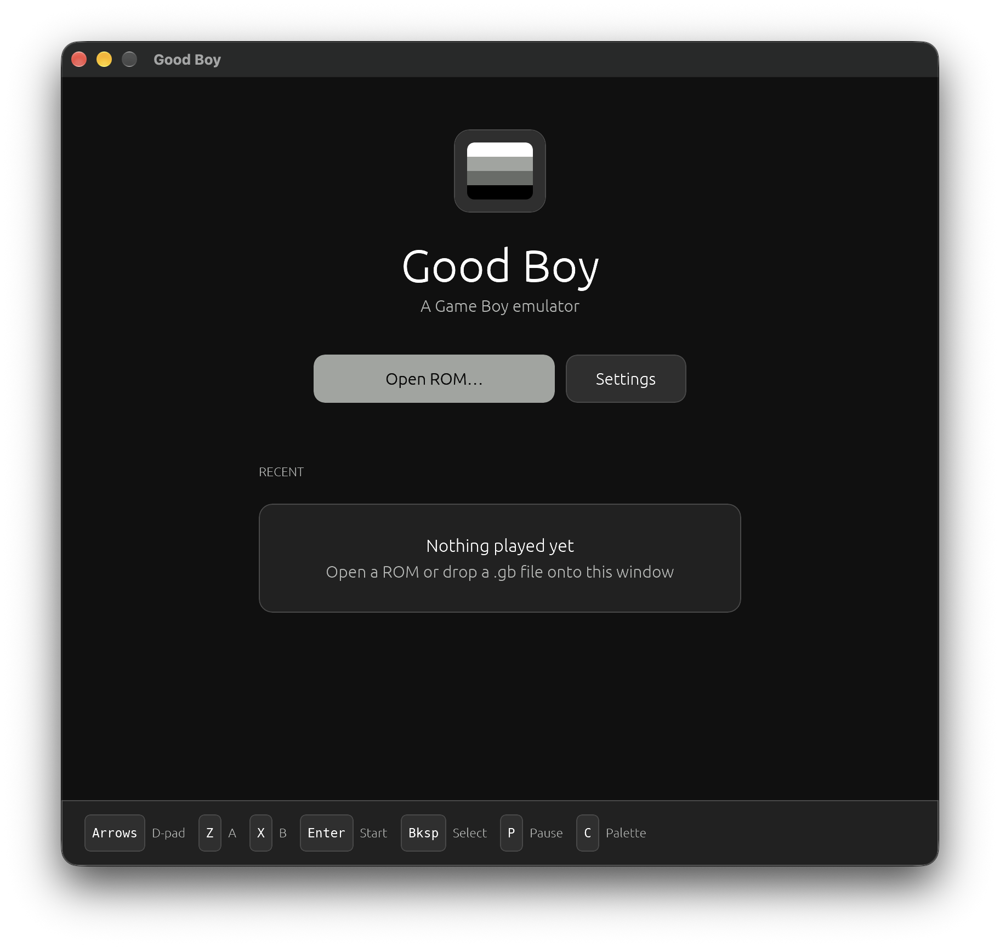
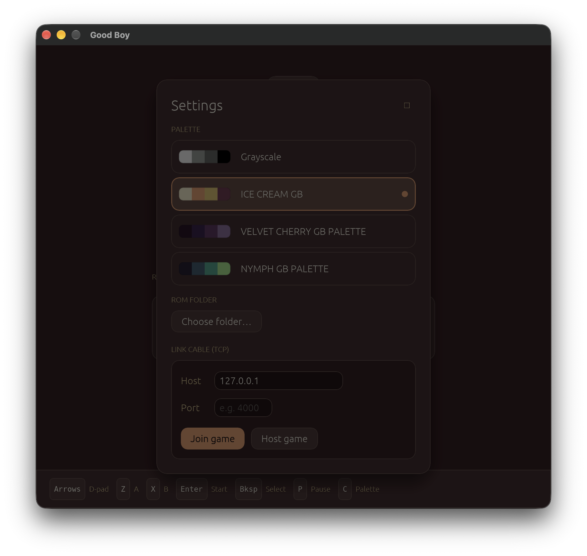
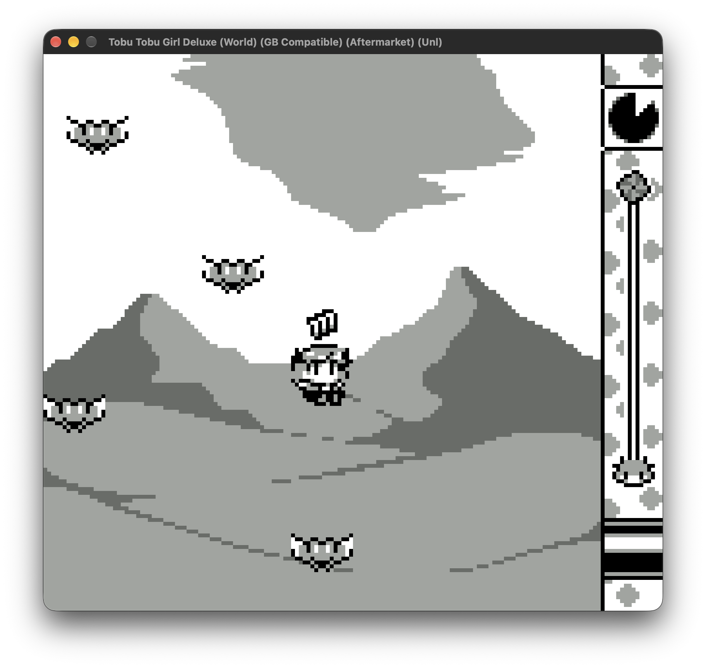

# Good Boy

A Game Boy (DMG) emulator written in Rust. The emulation core (`gb-core`) is a standalone library with no UI dependencies. The desktop frontend (`desktop`) uses SDL3 for video, audio and input and [egui](https://github.com/emilk/egui) for the interface.

## Screenshots

| Home screen | Settings | In-Game |
| :---: | :---: | :---: |
|  |  |  |

## Features

- **CPU:** the complete SM83 instruction set, with interrupts and `HALT`. Passes Blargg's `cpu_instrs` and `mem_timing`
- **Graphics:** a pixel-FIFO PPU with background, window and sprites (8×8 and 8×16), STAT interrupts and OAM DMA
- **Audio:** all four channels (two square waves with sweep, wave and noise) with envelopes, length counters and stereo panning
- **Timer:** `DIV`/`TIMA` built on the internal system counter, including its hardware quirks
- **Cartridges:** ROM only, MBC1, MBC3 and MBC5, with battery-backed saves
- **Link cable:** serial port with a pluggable link backend; two emulators can connect over TCP
- **Palettes:** outputs 2-bit shades, so any colour palette can be applied

## Building and running

Requires a recent stable Rust toolchain and the SDL3 C library to be installed. No ROMs are included. 

```sh
cd desktop
cargo run --release -- path/to/game.gb
```

Command-line options:

| Option | Description |
| --- | --- |
| `<rom>` | Open this ROM on launch |
| `--port <port>` | Join a link-cable host on `127.0.0.1:<port>` at startup |
| `--mute` | Disable audio output |

Run the core's tests with:

```sh
cd gb-core
cargo test
```

## Controls

| Key | Action |
| --- | --- |
| Arrow keys | D-pad |
| `Z` / `X` | A / B |
| `Enter` / `Backspace` | Start / Select |
| `P` | Pause |
| `C` | Next palette |

## Link cable

Open two instances of the emulator and load the same ROM in both.

1. In the first instance, open **Settings** and click **Host game**. It displays the port to connect to.
2. In the second instance, open **Settings**, enter the host's address and that port, and click **Join game**.
3. Select the 2-player mode in the game.

Use `127.0.0.1` to connect two instances on the same computer. Hosting on a LAN works too, but the host's firewall must allow incoming connections.

## Missing features

- **Game Boy only.** Game Boy Color (CGB) mode is not supported.
- **No MBC3 real-time clock.** Games that use the clock, such as Pokémon Gold/Silver, run, but time-based events won't work.
- **Limited mappers.** MBC2, MBC6, MBC7, HuC1, HuC3, MMM01 and other unusual cartridges are not supported.
- **No boot ROM.** The emulator starts in the post-boot state.
- **`STOP` is treated as a no-op**, and the `NR50` master volume isn't applied to the audio mix.
- **Not completely accurate:** See the test results below.
- **No save states**, rewind or fast-forward.
- **No controller support** and no remappable keys.
- **Link cable over TCP only**, between two instances of Good Boy.
- The "Choose ROM folder" setting does nothing.

## Test ROM status

Results from [Blargg's Game Boy test ROMs](https://github.com/retrio/gb-test-roms).

| Test suite | Passed | Status |
| --- | :---: | --- |
| `cpu_instrs` | 11/11 | Pass |
| `mem_timing` | 3/3 | Pass |
| `mem_timing-2` | 3/3 | Pass |
| `dmg_sound` | 8/12 | Partial |
| `oam_bug` | 2/8 | Partial |
| `instr_timing` | 0/1 | Fail |
| `interrupt_time` | 0/1 | Fail |
| `halt_bug` | 0/1 | Fail |

**Summary:** 27 of 40 tests pass.


## Credits & Attributions

### Icons

[Retro Game Console Icons](https://github.com/KyleBing/retro-game-console-icons) by [KyleBing](https://github.com/KyleBing).

Licensed under [CC BY 4.0](https://creativecommons.org/licenses/by/4.0/).

### Color Palettes

Color palettes sourced from [Lospec](https://lospec.com/):

- [Ice Cream GB](https://lospec.com/palette-list/2bit-demichrome)
- [Velvet Cherry GB](https://lospec.com/palette-list/velvet-cherry-gb)
- [Nymph GB](https://lospec.com/palette-list/nymph-gb)

### Test ROMs

[Blargg's Game Boy test ROMs](https://github.com/retrio/gb-test-roms) by Shay Green (blargg).

### Screenshots

[Tobu Tobu Girl](https://tangramgames.dk/tobutobugirl/) by [Tangram Games](https://tangramgames.itch.io/).

Licensed under [CC BY 4.0](https://creativecommons.org/licenses/by/4.0/).


## Contributing

If you've decided that contributing to my personal Game Boy emulator is a good use of your time, PRs are welcome.

## License

Good Boy is licensed under the MIT License. See [LICENSE](LICENSE) for details.